# Acadexa — Student Academic Support & Consultancy Platform

**Your Academic Journey, Simplified.**
Professional Academic Support. Personalized Guidance. Complete Confidentiality.

A full-stack **MERN** application (MongoDB, Express, React + Vite, Node) written entirely in JavaScript/JSX.
It pairs a premium animated public website with a working student portal and an administrative back office —
real authentication, real orders, real quotations, verified payments, private documents, audit logging and privacy tooling.

---

## 1. What is running right now

| Layer | URL / port | Notes |
|---|---|---|
| React app (Vite dev server) | `http://localhost:5173` (preview: port **5173**) | Proxies `/api` → `http://127.0.0.1:4000` |
| Express API | `http://localhost:4000/api` | Health check: `/api/health` |
| MongoDB 7 | `mongodb://127.0.0.1:27017/studentdesk` | Local `mongod` in `.data/db` (see §2) |

### Seeded accounts

| Role | Email | Password | Lands on |
|---|---|---|---|
| **Administrator (primary)** | `yuglakhani99@gmail.com` | `#yug7979.` | `/admin` |
| Consultant | `consultant@acadexa.example` | `Consult@12345` | `/admin` (assigned orders only) |
| Support staff | `support@acadexa.example` | `Support@12345` | `/admin` |
| Student | `student@acadexa.example` | `Student@12345` | `/dashboard` |

The student account includes demo data: one paid + delivered order, one order with a quotation awaiting approval.

> **Change these credentials before any public deployment.** The administrator account is a seed and its
> password is shared in this document — rotate it (Admin → Settings, or re-seed with `ADMIN_EMAIL` /
> `ADMIN_PASSWORD` set in `server/.env`) before going live. The former demo `owner@` and `admin@` accounts
> are removed by the seed so only one administrator exists. Seed with `node utils/seed.js --demo` for demo data.

---

## 2. Running locally from a clean checkout

```bash
# 1. MongoDB (any MongoDB 6/7 instance works; this helper downloads a local binary if needed)
./scripts/start-mongo.sh
#    …or point MONGODB_URI at any existing instance

# 2. API
cd server
cp .env.example .env          # then edit secrets
npm install
npm run seed -- --demo        # settings + 10 services + demo accounts (+ demo orders)
npm run dev                   # http://localhost:4000

# 3. Web
cd ../client
npm install
npm run dev                   # http://localhost:5173
```

### Environment variables (`server/.env`)

| Key | Purpose |
|---|---|
| `MONGODB_URI` | MongoDB connection string |
| `JWT_SECRET` | Token signing key — use 64+ random characters in production |
| `JWT_EXPIRES_IN` | Session lifetime (default `7d`) |
| `COOKIE_NAME` | httpOnly session cookie name |
| `CLOUDINARY_CLOUD_NAME` / `CLOUDINARY_API_KEY` / `CLOUDINARY_API_SECRET` | Cloudinary credentials. **When all three are set every uploaded document is stored in Cloudinary as a private asset**; without them the server falls back to local disk so development keeps working |
| `CLOUDINARY_FOLDER` | Folder inside Cloudinary (default `acadexa/documents`) |
| `CLIENT_ORIGIN` | Comma-separated allowed origins for CORS |
| `PAYMENT_PROVIDER` | `sandbox` (default) or `razorpay` |
| `PAYMENT_KEY_ID` / `PAYMENT_KEY_SECRET` | Gateway credentials — **never commit** |
| `PAYMENT_WEBHOOK_SECRET` | HMAC secret for `POST /api/payments/webhook` |
| `UPLOAD_DIR`, `MAX_FILE_MB` | Private storage location and upload limit |
| `SUPPORT_EMAIL` | Public support address |

Secrets live **only** in environment variables. Nothing sensitive is stored in the database or exposed to the browser.

---

## 3. Scripts

**server** (`cd server`)
- `npm run dev` — Node `--watch`
- `npm start` — production start
- `npm run seed` / `npm run seed -- --demo` — idempotent seeding
- `npm test` — 38 integration tests (separate `studentdesk_test` database)

**client** (`cd client`)
- `npm run dev` — Vite dev server
- `npm run build` — production build to `dist/`
- `npm run preview` — serve the build locally

---

## 4. Project structure

```
acadexa/
├── server/
│   ├── config/        env.js, db.js
│   ├── models/        User, Service, Order, Quotation, Payment, FileRecord, Message,
│   │                  Notification, SupportTicket, Enquiry, Review, ConsultationBooking,
│   │                  PrivacyRequest, AuditLog, Coupon, SystemSettings, Counter
│   ├── routes/        auth, users, services, orders, quotations, payments, files,
│   │                  messages, notifications, support, reviews, bookings, privacy, admin
│   ├── controllers/   request handling + business rules
│   ├── services/      storage (Cloudinary/local driver), sessions, payments (gateway adapter),
│   │                  notify (in-app + email), audit, orders, studentPurge
│   ├── middleware/    auth/roles, validation, rate limiting, upload, errors
│   ├── utils/         constants, references, seed, catalogue (price sheet)
│   ├── jobs/          quotation expiry, deadline reminders, retention purge
│   ├── tests/         api.test.js (node:test)
│   ├── app.js  server.js
└── client/src/
    ├── assets/        acadexa-logo.png (brand mark)
    ├── components/    ui/, layout/, navigation/, animations/, forms/, dashboard/
    ├── pages/         public/, auth/, student/, admin/
    ├── context/       AuthContext
    ├── hooks/         useSettings, useReducedMotion, useCountUp
    ├── lib/           api client, formatters
    ├── routes/        ProtectedRoute
    └── App.jsx  main.jsx  index.css
```

Request flow: **Routes → Middleware → Controllers → Services/Models → MongoDB**.

---

## 5. Order lifecycle implemented

```
Pending Review → (More Information Required) → Quotation Sent → Awaiting Payment
   → Confirmed → In Progress → (Awaiting Student Information) → Ready for Review
   → Delivered → (Revision Requested → In Progress → Delivered) → Completed
   ↘ Rejected / Cancelled                          Refund Pending → Refunded
```

`server/utils/constants.js` holds the allowed transition table. `PATCH /orders/:id/status` rejects any
transition that is not permitted, and every significant change appends to the order's `activity`
array with actor, role, note and timestamp. Deadline changes, quotes, payments, refunds, file uploads
and privacy operations are additionally written to the audit log.

---

## 6. Security & privacy behaviour (as actually implemented)

- **Passwords**: bcrypt (cost 12), never selected by default (`select: false`), never returned by any endpoint.
- **Sessions**: signed JWT in an httpOnly, sameSite=lax cookie (`secure` in production); optional
  `Authorization: Bearer` for tooling. `GET /auth/me` answers `200 {user:null}` for anonymous callers so
  the client can probe state without spurious 401s.
- **Authorisation**: role checks (`requireAdmin`, `requireStaff`) and ownership checks in the controller
  for every student-scoped resource. Consultants are restricted to assigned orders.
- **Validation**: Zod schemas on every write endpoint; Mongoose schema validation as a second layer.
- **Rate limiting**: global API limiter, stricter limiter on auth routes, plus a write limiter on request creation.
- **Headers/CORS**: Helmet, explicit origin allow-list with credential support.
- **Uploads**: MIME allow-list, size limit, randomised storage keys, files stored **outside** the web root;
  downloads stream only after a server-side authorisation check (`GET /files/:id/download`).
  Retention: 24 months, purged hourly by a job.
- **Payments**: create → provider order → server-side HMAC signature verification (or signed webhook);
  duplicate provider references are rejected by a unique index; a failed client-side signature never
  marks money as received. Card data never touches the server.
- **Auditing**: actor, role, action, entity, reference, metadata, IP, user agent. No passwords or tokens.
- **Privacy**: Privacy Center requests (access / correction / export / deletion) with references and
  status tracking; deletion anonymises personal identifiers while retaining statutory financial records.

**Honest limits** (also stated in the UI and policies): email delivery uses a logging adapter in this
environment; the payment gateway runs in sandbox mode (no live charge); there is no SMS/WhatsApp bot,
no OCR of uploaded images, and no claim of absolute confidentiality or perfect security.

---

## 7. Feature map

**Public** — animated landing page (staggered hero, floating document cards, section reveals,
reduced-motion support), About, Services catalogue with search/filter/sort, Service detail pages with
inclusions/exclusions/requirements/revision terms/integrity terms, a per-service price sheet
(softcopy vs handwritten columns plus additional charges), a full Pricing page (billing models, recommended
starting prices, every service's rate card, additional charges, eight pricing/order policies), How It Works, FAQs
(searchable, categorised), Contact form (creates a real enquiry + admin notification), Privacy Policy,
Terms of Service, Refund & Cancellation Policy, Academic Integrity Policy, cookie notice, 404.

**Student** — registration, login, forgot/reset password, verification token, dashboard with live counts,
service catalogue, request form with validated uploads, orders list with status filters and pagination,
order detail (overview, timeline, quotations, messages, documents, revisions, feedback), quotations
accept/decline, payments with sandbox checkout and receipts, documents library, order messaging,
support tickets, consultation booking with slot conflicts prevented server-side, Privacy Center, profile /
password / notification preferences / account deactivation and deletion requests.

**Admin** — metrics dashboard with date filters, definitions and charts (orders, revenue, service demand,
status mix), order queue with search/filter/deadline filters and CSV export, order workspace
(status transitions, assignments, deadline changes, internal notes, deliverables, messaging), quotation
creation and versioning, payments with refunds, student directory with account controls, service CRUD with
publish/unpublish and reorder, support inbox (tickets + public enquiries), deadline calendar, review
moderation with consent-gated publication, team & workload, reports with export, privacy request
processing, audit logs, system settings (business identity, defaults, public content, notifications,
integration status, coupons).

---

## 8. Tests

```bash
cd server && npm test
```

Covers: health, registration validation and duplicates, login success/failure, anonymous session probe,
request creation and validation, student status tampering (403), cross-student isolation (403), quotation
creation, illegal status jumps (400), quotation acceptance, payment intent, invalid-signature rejection,
valid signature confirmation, duplicate payment rejection, private file authorisation, revision-limit
enforcement, support ticket and privacy request creation, audit-log assertions, consultant scoping,
public settings leaking no secrets, the published price sheet (5 starting prices, 6 additional charges,
8 policies, every catalogue service carrying a price table), student deletion (confirmation required, cascade
purges orders/quotations/payments, staff accounts refused), session management (creation, per-device
revocation, cross-user isolation, logout, password change revoking other devices) and cookie consent
(accept all / reject optional / contradictions refused, append-only history, admin-only counts, and
privacy-minimal analytics events) and the mobile number (required at signup, normalised, admin-visible,
sanitised on update). **49/49 passing.**

An end-to-end UI pass (Playwright) was also run against the dev server covering: submit request →
admin quotation → student acceptance → sandbox payment → deliverable upload → Delivered, with zero
console/page errors.

---

## 9. Production checklist

1. **Secrets** — generate a strong `JWT_SECRET`; set payment keys and webhook secret; never commit `.env`.
2. **HTTPS** — terminate TLS at a proxy/CDN and set `NODE_ENV=production` (enables `secure` cookies).
3. **CORS** — set `CLIENT_ORIGIN` to your real web origin(s) only.
4. **Database** — use a managed MongoDB with auth enabled, network restrictions and daily backups;
   test a restore.
5. **Storage** — for multi-instance deployments move `UPLOAD_DIR` to private object storage (S3-compatible)
   and issue short-lived signed URLs from `GET /files/:id/download`.
6. **Email** — replace the logging adapter in `server/services/notify.js` with a transactional provider
   (Resend/SES/Postmark) and monitor delivery states.
7. **Payments** — install the provider SDK, implement `createOrder`/refund calls in
   `server/services/payments.js`, register the webhook URL with the provider and verify signatures in production.
8. **Build & serve** — `cd client && npm run build`, serve `dist/` from a CDN, and put the API behind the
   same domain (or configure CORS + credentials accordingly).
9. **Operations** — enable error monitoring, keep the hourly jobs running (quotation expiry, reminders,
   retention purge), rotate logs, review `audit-logs` regularly, document an incident-response contact.
10. **Content** — update `SystemSettings` (business name, contact details, policies) to your real details
    before launch; the seeded text is placeholder content.

---

## 10. Deliberate design decisions

- **No fabricated social proof.** There are no invented testimonials, customer counts, certifications or
  success statistics anywhere in the product. The testimonial section only renders when a student has
  submitted feedback *and* consented to publication *and* an administrator has approved it.
- **Scope honesty.** Every service page lists exclusions and revision terms; the academic-integrity
  condition must be accepted before a request can be saved.
- **Backend-first authorisation.** Hiding a button never substitutes for a server check; the tests assert
  this directly.
- **Money is never assumed.** Revenue metrics sum only `Verified` payments; failed or pending attempts are
  excluded and labelled as such.

_Last updated: 29 October 2026._

---

## 11. Pricing model and the published rate card

Two things are deliberately separated: **what is published**, and **what is charged**. The published figures
are indicative ranges; the charged amount is always the quotation the student approves in writing.

**Source of truth** — `server/utils/catalogue.js`:

| Export | Purpose |
|---|---|
| `CATALOGUE` | The 5 service categories, each with `priceTable` rows (`{item, softcopy, handwritten}`), `startingPrice`, `priceNote`, scope, requirements, revision terms |
| `STARTING_PRICES` | The 5 recommended entry prices shown on the Pricing page and home page |
| `ADDITIONAL_CHARGES` | Urgent 24h (25–40%), handwritten diagram (₹20–50), printing / binding / courier at actual cost, out-of-scope revision requiring a separate quotation |
| `PRICING_POLICIES` | The 8 pricing & order policies (pay per work, quotation first, approval before payment, page definition, handwritten delivery, bulk 5–10%, revisions, academic integrity) |
| `RETIRED_SLUGS` | Legacy service slugs that the seed unpublishes so old links stop resolving |

**Categories and their lowest published figure** (used for "from ₹X" labels and price sorting):

| Category | Slug | From |
|---|---|---|
| Practical & Lab Manual Support | `practical-lab-manual-support` | ₹10 (diagram, softcopy) |
| Assignment & Notes Support | `assignment-notes-support` | ₹8 per page |
| Project Documentation | `project-documentation` | ₹20 (ER diagram) |
| Presentation & Viva Preparation | `presentation-viva-preparation` | ₹49 (speaker notes / viva sheet) |
| Technical & Research Support | `technical-research-support` | ₹29 (programming question) |

Prices are stored as display strings so ranges survive intact (`₹15–₹25`, and `—` where a column does not
apply). Only `startingPrice` is numeric, because it is used for sorting (`/api/services?sort=priceAsc`) and
for the "from" labels.

**Where it surfaces**: `Service.priceTable`, `Service.priceNote`, `Service.additionalCharges` on the detail
page; `SystemSettings.pricing` (via `GET /api/public/settings`) drives the Pricing page, the home-page price
block and each service's fallback charge table. Editing a price therefore means editing `catalogue.js` and
re-running the seed — the API does not accept price-table edits from the admin UI:

```bash
cd server && node utils/seed.js     # upserts the 5 categories, settings & pricing, unpublishes retired slugs
```

Re-running is safe: services and settings are upserted, accounts are skipped if they already exist.

**Billing rules the UI states explicitly** — pay per work (no subscription, membership, or auto-renewal);
quotation before payment; approval before payment; one page = one side of A4; handwritten delivery stated in
the quotation; bulk discounts of roughly 5–10% only inside a quotation; revisions limited to the agreed
scope; and no assessed work produced on a student's behalf.

---

## 12. Account fields and the mobile number

| Field | Required | Stored as |
|---|---|---|
| Full name | Yes | `users.name` |
| Email | Yes | `users.email` (lowercased, unique) |
| **Mobile number** | **Yes** | `users.profile.phone`, normalised to `+919876543210` |
| Password | Yes | `users.passwordHash` (bcrypt cost 12) |
| Phone, institution, course, city, bio | No | `users.profile` |

**Why the number is required:** the team needs to reach a student when a deadline, a quotation or a missing
detail affects a live order. It is shown only to the student and to Acadexa staff — never to other students,
never on a public page, and it is included in the account-deletion purge.

**Validation** (`server/utils/phone.js`, mirrored in both forms so the UI rejects exactly what the API rejects):

| Input | Result |
|---|---|
| `9876543210` | ✅ `+919876543210` |
| `09876543210` | ✅ leading 0 dropped |
| `+91 98765 43210`, `+91-98765-43210` | ✅ spaces/dashes stripped |
| `+1 (415) 555-2671` | ✅ kept as `+14155552671` |
| `12345`, `abcdefghij`, `+0123456789`, `5876543210` | ❌ 400 with a field-level message |

**Where it surfaces:** **Admin → Students** shows each number as a click-to-call link (`tel:`) and flags
`No mobile number on file` in amber; a student dashboard banner asks existing accounts to add one.
Registration refuses a missing number, and the Privacy Policy "Information we collect" section now states
the purpose plainly instead of listing the phone as optional.

---

## 13. Deleting a student (admin)

**Students → Delete** (next to each student's name/pill row). The button opens a confirmation dialog that
first loads a real count of everything attached to that account, then requires the word `DELETE` to be typed.
Nothing is removed until that confirmation is sent to the server.

**What gets deleted — everything, by design:**

orders · quotations · payments and receipts · order and ticket messages · uploaded files (records **and** the
physical files in `UPLOAD_DIR`) · support tickets · consultation bookings · reviews · privacy requests ·
notifications · audit entries the student authored · then the user record itself.

**What survives:** one audit entry, `student.deleted`, with the email masked (`p***2@test.local`) and the
per-record counts — so the removal stays accountable without the log becoming a copy of the deleted data.

| Endpoint | Purpose |
|---|---|
| `GET /api/admin/students/:id/delete-preview` | Counts per collection, for the dialog |
| `DELETE /api/admin/students/:id` | Body must be exactly `{"confirm":"DELETE"}` |

Guards: admin/owner only (403 otherwise), students can never reach it, staff accounts are refused (400 — this
endpoint only handles students), self-deletion is refused, and a missing or lowercase `confirm` is a 400.

The cascade lives in `server/services/studentPurge.js` so the rules are in one place rather than in a controller.

**Regulatory note:** this is a true hard delete. If you need to retain financial records for statutory periods,
export them before deleting, or ask me to add a retention variant that anonymises payments instead of deleting them.

---

### What deletion removes — including the stored documents

Deleting a student is a hard delete across **both** stores. Proven by an integration test and a live run:

| Store | What is removed |
|---|---|
| MongoDB (Atlas or local — same code path) | the user, orders, quotations, payments, messages, reviews, support tickets, consultation bookings, privacy requests, notifications, the student's own audit entries, and every `filerecord` |
| Cloudinary / file storage | **every stored asset** — the student's uploads, deliverables on their orders and ticket attachments — destroyed via `uploader.destroy` as a private asset before the database records go |
| Local disk fallback | the file is unlinked when Cloudinary is not configured |

**Failure handling.** A storage error does not quietly leave an untracked document in the bucket: the delete is
retried once, and if it still fails a minimal, PII-free pointer is written to `orphanassets` (public id, resource
type, error). The hourly job (`orphanCleanupJob`) keeps retrying until the provider confirms the asset is gone,
then removes the pointer. The admin response reports `storedAssets` and `storedAssetsPending`, so a partial failure
is visible instead of silent.

**Retained:** one audit entry recording that the deletion happened, with the email masked (`d***f@test.local`) and
counts only — no documents, no contact details.

Live verification against the running server: upload a PDF → delete the student → the file disappears from
`.data/uploads`, `filerecords` for that owner drops to 0, the user row is gone and `orphanassets` is empty:

```
delete 200
"deleted": { "files": 1, "storedAssets": 1, "storedAssetsPending": 0, ... }
on disk after: GONE
user rows: 0 | file records: 0 | orphan assets: 0
```

## 14. Cookie consent and sessions

### Consent categories

| Category | Default | What it actually does |
|---|---|---|
| Strictly necessary | Always on | The httpOnly `sd_token` session cookie. Cannot be disabled — you cannot stay signed in without it. |
| Analytics | **Off** | First-party page-view counts in `analyticsEvents` (path + random visitor id). No IP, no query strings, no third party. |
| Marketing | **Off** | Nothing is installed. The switch exists so consent is recorded before any tag could ever be added. |

**Flow** — banner with three equally weighted actions (`Accept all`, `Reject optional`, `Customise preferences`).
Closing the banner (×) counts as *rejecting* optional cookies, never as accepting. Preferences can be reopened
any time from **Cookie preferences** in the footer, or read back per account under
**Dashboard → Privacy Center → Cookie consent**.

**Storage** — the decision is written to `localStorage` (`acadexa_consent_v1`) so it is available before any
request and survives an outage, and a copy is posted to `POST /api/consent` as evidence. That record holds the
choice, the policy version, an append-only history of changes and a **hashed** IP — never a fingerprint or the
raw address. Bumping `CONSENT_VERSION` (client) and `CONSENT_POLICY_VERSION` (server) re-prompts everyone.

**Enforcement, not decoration** — nothing analytics-related runs without consent:

- the page-view beacon is only mounted when `consent.analytics` is true (verified: 0 requests after reject);
- `<ConsentGate category="analytics">…</ConsentGate>` exists so any future script must pass through the same gate;
- the server rejects contradictory payloads (`reject_optional` carrying analytics consent, or `accept_all` without it).

| Endpoint | Access |
|---|---|
| `POST /api/consent` | Public (validates that the action matches the categories) |
| `GET /api/consent/me` | Signed-in user — their own consent history |
| `POST /api/consent/analytics/event` | Public, minimal payload, query strings stripped |
| `GET /api/consent/admin/consents` | Admin — counts only, no visitor ids |
| `GET /api/consent/admin/summary` | Admin — consent-gated page views |

### Session management

The JWT cookie now carries a random `sid`; the server stores only its SHA-256 hash in `sessions`, so a database
read cannot be replayed as a credential and a session can be revoked instantly.

| Behaviour | Result |
|---|---|
| Sign in | New session row + httpOnly cookie. "Keep me signed in" (ticked by default) = 90-day persistent cookie, renewed on use; unchecked = browser-session cookie with a 1-day server expiry |
| Sign out | Session marked revoked and the cookie cleared — the old token is dead, not just deleted client-side |
| Sign out one device | **Privacy Center → Active devices** (device, IP, last seen, expiry) |
| Sign out everywhere | `POST /api/auth/logout-all` |
| Change password | Other sessions revoked automatically; the current device stays signed in |
| Reset password | **All** sessions revoked |
| Suspended / deactivated account | Rejected on every request regardless of a valid token |

Revoked and expired sessions are purged by the hourly job and a TTL index. Tokens are never written to
`localStorage`, and the privacy policy now states all of this as implemented.

#### Staying signed in (persistent login)

Users should not have to re-enter credentials every time they open the site, so signing in is persistent by default:

1. The sign-in form prefills the last email used on the device (`localStorage['acadexa_last_email']` — an email
   address only, never a password or a token) and leaves **Keep me signed in on this device (90 days)** ticked.
   `remember` is declared in the form's `defaultValues`; a react-hook-form field that is missing from
   `defaultValues` submits `undefined`, which silently downgraded every login to a 1-day session.
2. The API issues a 90-day `sd_token` cookie (`Max-Age=7776000`) plus a 90-day server-side session row.
3. **Sliding renewal:** every authenticated request refreshes `lastSeenAt`, and once fewer than 60 days remain
   the session expiry and the cookie are both pushed back to a full 90 days. An active user is therefore never
   signed out; an abandoned device lapses on its own within 90 days.
4. Unticking the box (or `remember: false`) keeps the stricter behaviour: a browser-session cookie that dies when
   the browser closes, with a 1-day server expiry.
5. Visiting `/login` while already signed in redirects straight to the dashboard/admin area.

Sessions stay revocable — "Active devices" lists each one and can end it immediately, and changing the password
still signs out every other device. Because the login state is a server-side session rather than a credential
cached in the browser, a user on a second device only signs in once: the browser's own password manager offers to
remember the credentials, and the server keeps that device signed in for 90 days after the first success.

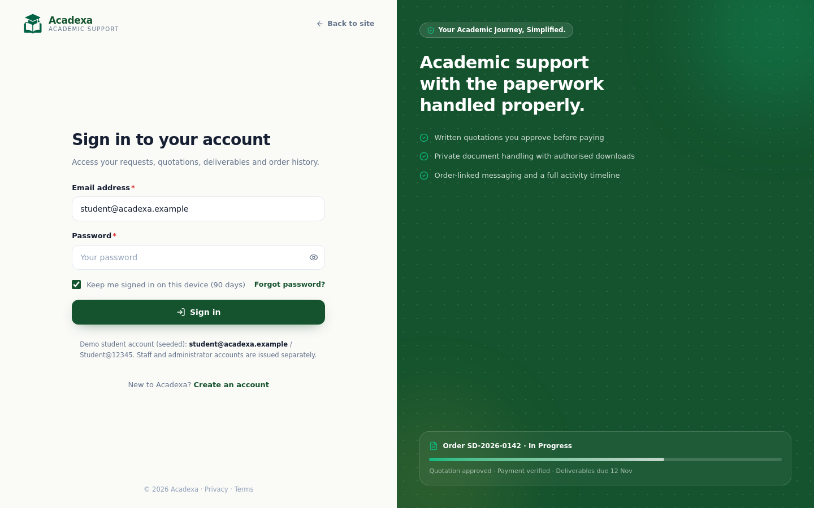

---

## 15. File storage (Cloudinary) and deletion on completion

Students upload reference PDFs (and DOCX/XLSX/PPTX/CSV/ZIP/images) with a request; staff upload deliverables.
Every file is stored **privately** and can only be fetched through an authorised route.

| Concern | How it works |
|---|---|
| Driver | `server/services/storage.js` picks **Cloudinary** when `CLOUDINARY_CLOUD_NAME`, `CLOUDINARY_API_KEY` and `CLOUDINARY_API_SECRET` are set, otherwise local disk (`UPLOAD_DIR`) |
| Privacy | Uploaded with `type: 'private'` + `access_mode: 'authenticated'`. No public delivery URL exists, and none is stored on the record |
| Resource type | PDFs and images are `image` resources; DOCX/XLSX/PPTX/ZIP/CSV are `raw`. The type is stored per file because deletion must repeat it |
| Naming | The original filename is randomised (`Lab-report-3f9c1a77b2e4d018`) and kept as display metadata only |
| Download | `GET /api/files/:id/download` re-checks ownership/assignment, then streams the asset using a 2-minute signed private URL generated server-side. Credentials never reach the browser |
| Limits | 8 files per request, `MAX_FILE_MB` per file (10 MB default), MIME allowlist enforced before upload |
| Records | Each upload creates a `FileRecord` with `provider`, `publicId`, `resourceType`, size, purpose and a 24-month `retentionUntil` |
| Fallback | Files uploaded before Cloudinary was configured keep `provider: 'local'` and are still downloadable and deletable |

### "Mark completed" deletes the documents

On the admin order page the **Mark completed** button opens a confirmation that lists exactly what will be destroyed,
then completes the order and purges its files.

1. `GET /api/files/order/:id/purge-preview` (admin) returns the files attached to that order.
2. `PATCH /api/orders/:id/status` with `status: "Completed"` sets `completedAt` and calls `purgeOrderFiles()`.
3. Each asset is destroyed in Cloudinary (`uploader.destroy` with the recorded resource type and `type: 'private'`).
   **Deletion is scoped to that one order** — the same student's other orders are untouched.
4. The `FileRecord` is kept with `isDeleted`, `purgedAt`, `purgedBy` and `purgeReason: 'order_completed'`, so the
   order history can still say "files deleted on <date>" while the document itself is unrecoverable.
5. The order timeline records `Files deleted from cloudinary (2)` and an `order.status_changed` audit entry is written.
6. A failed Cloudinary delete is reported in the response, logged to the timeline as needing attention, and the
   record is **not** marked purged — so nothing silently claims to be deleted when it is not.

The same driver is used by the retention job (`purgeReason: 'retention_expired'`) and by student deletion
(`purgeReason` set via the cascade), so a removed account no longer leaves documents in the bucket.

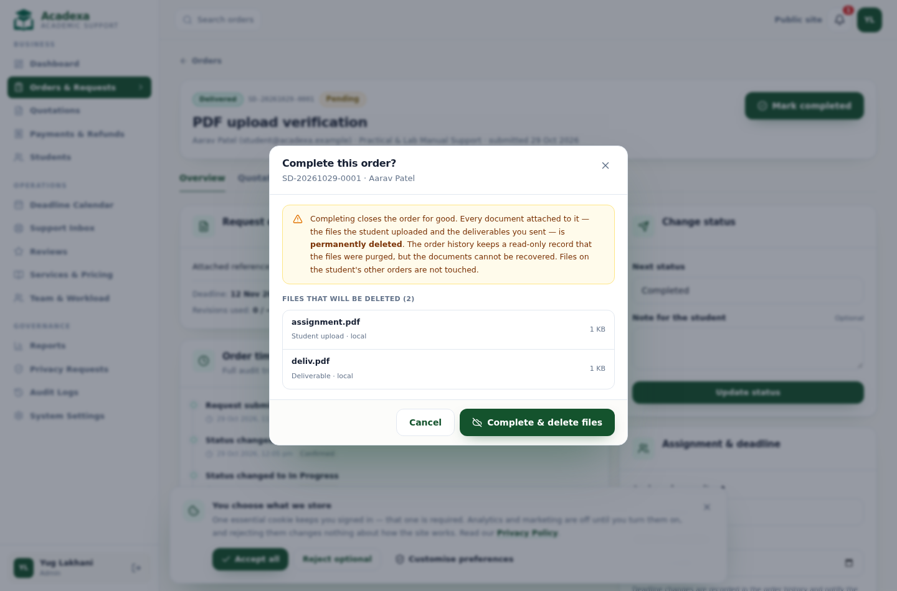

---

## 16. First-visit intro (preloader)

A short branded intro covers the gap between the HTML arriving and React rendering the homepage.
It is two layers, so there is never a blank white screen and the animation never *adds* time.

| Layer | What it does |
|---|---|
| `index.html` splash | Plain HTML + CSS, inlined in `<head>`. Paints at ~76 ms, before the JS bundle is parsed: logo scales in, then `ACADEXA` letters rise one by one, the tagline fades up and a thin progress rule fills |
| `components/ui/Preloader.jsx` | Takes over once React mounts, removing the static node and rendering the identical frame, then fades the overlay out to reveal the page |

Behaviour:

- **Budgeted, not fixed:** the hold is `1050 ms − already elapsed − fade`, measured from navigation start via
  `performance.now()`. A slow connection shortens the hold instead of delaying the user. Measured in a browser:
  first paint 76 ms, React handoff 393 ms, intro fully gone **1057 ms**.
- **Once per session:** `sessionStorage['acadexa_intro_seen']` is written on show, so reloads, in-app navigation
  and returning from a link never replay it. A tiny inline script sets `.sd-skip-intro` *before first paint* when
  the intro is due to be skipped, so there is no flash of intro on the way in.
- **Reduced motion:** `prefers-reduced-motion: reduce` skips it entirely (the CSS splash is hidden by the same
  class) — no movement, no overlay, the page appears immediately.
- **Mobile:** all sizes use `clamp()`, so the mark, wordmark, tagline and rule scale at 390 px exactly as at 1440 px.
- **Accessibility:** the overlay is `role="status"` with `aria-label="Loading Acadexa"`; the wordmark and tagline
  are `aria-hidden` because the label already announces the brand. Scroll is locked only while the overlay is up
  and always restored, including on unmount.


---

## 17. The USP: free lab manual creation with print & bind

The headline offer is **"Your Lab Manual, Created Free!"** — creation of the lab manual is free *when the same
manual is printed and bound through Acadexa*. Printing, binding and delivery are always charged at actual cost.

**The condition is enforced in content, not just mentioned once.** `client/src/lib/offers.js` holds the single
source of truth for the wording (`FREE_LAB_MANUAL`), and every placement imports it, so the claim cannot drift:

| Placement | Component / file | Form |
|---|---|---|
| Homepage hero, above the fold | `components/marketing/FreeLabManualBanner.jsx` (`variant="hero"`) | Promotional card with badge, headline, supporting line, the condition, and both CTAs: **Create Your Lab Manual** → `/services/practical-lab-manual-support`, **Explore Printing Services** → `/services/printing-binding` |
| Hero badge | `Home.jsx` | "Free lab manual creation · with print & bind" replaces the generic availability pill |
| Services listing | `Services.jsx` | Same hero card above the filter bar |
| Lab manual service page | `ServiceDetail.jsx` (slug-gated) | Card beneath the service header |
| Printing & binding service page | `ServiceDetail.jsx` (slug-gated) | Same |
| Pricing | `Pricing.jsx` | Card above the rate card, plus a published policy row |
| About us | `About.jsx` | "Save time and money" section explaining the offer, with the condition in a bordered callout |
| FAQs (home + FAQ page) | `Home.jsx`, `Faq.jsx` | "Is lab manual creation really free?" — answered with the condition first |
| Every placement on Home, Pricing, Services, both offer service pages and Contact | `components/marketing/ContactPrintingInfo.jsx` | **Contact & bulk printing** block: clickable `tel:` + WhatsApp **9825751614**, "Contact for Consultancy" and "Enquire About Bulk Printing" CTAs, free-vs-paid split — see §21 |

### The new Printing & Binding service

`printing-binding` was added to the catalogue (`server/utils/catalogue.js`): quoted per job, `startingPrice: 0`
(rendered as "Quoted per job", never "₹0"), with a price sheet where every printing and binding row reads
**Actual cost** and the only free row is *Lab manual creation, with a print & bind order → Free*.

The lab manual service states the offer in `included` ("No charge for creating the manual when the same manual is
printed and bound through Acadexa") and the limit in `excluded` ("Printing, binding, courier and delivery charges
(billed at actual cost — never free)" and "Free creation when the manual is printed or bound somewhere else").
A pricing policy row ("Free lab manual creation") publishes the same condition on the public pricing page.

**Guarding against a misleading claim:** tests assert that no printing or binding row can be priced "Free", that
the excluded list states plainly that printing and binding are charged, and that the offer always appears with its
condition (`server/tests/api.test.js`, "the free lab manual offer is stated with its condition and never free printing").

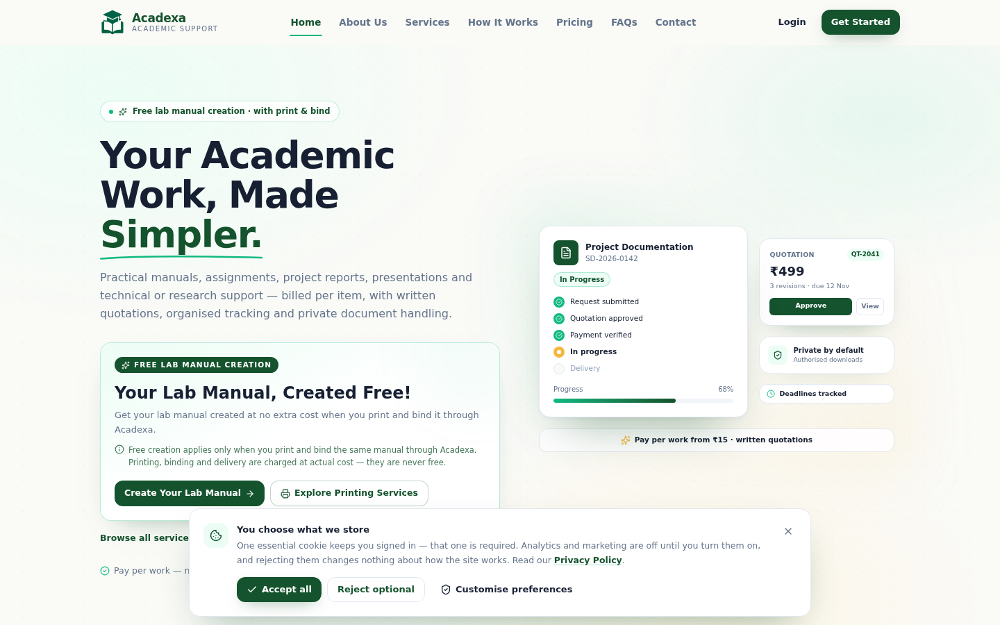

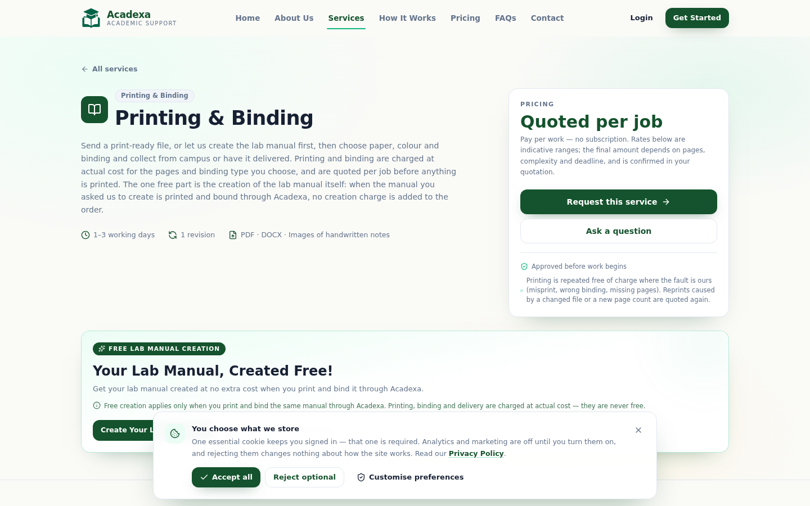

---

## 18. Light and dark mode

A full theme switch, **once per user**, remembered across pages, tabs and visits.

| Concern | How it works |
|---|---|
| Toggle | `components/ui/ThemeToggle.jsx` — a real `<button>` with `aria-pressed` and a descriptive label; the sun/moon icon crossfades (motion disabled under reduced-motion). Placed in the public navbar, the dashboard top bar and the auth pages |
| Default | **Follows the operating system** on a first visit. The choice is stored in `localStorage['acadexa_theme']` as `'light'`, `'dark'` or `'system'` |
| No flash | An inline script in `index.html` sets `<html class="dark">` before the first paint, so a dark-mode user never sees a white flash — this matters because the first-visit intro paints before React loads |
| Provider | `context/ThemeContext.jsx` owns the preference, applies the class, updates `<meta name="theme-color">`, listens for OS appearance changes while in `system` mode, and syncs across tabs via the `storage` event |
| Implementation | Tailwind v4 `@custom-variant dark` (class-based, not the media query, so the toggle can override the OS). The app is written against semantic tokens, so most of the theme flips by redefining `--color-canvas`, `--color-ink`, `--color-muted`, `--color-line` and `--color-mint` in `.dark` |
| Literal colours | The design also used literal `bg-white`, slate shades and alert tints; these are remapped in one block in `index.css` so they follow the theme without touching 100+ call sites |
| Green fills | The accent token becomes bright green in dark mode (it doubles as a text colour), so elements that use it as a *background* behind white text are pinned to a dark fill — otherwise the label would vanish |
| Logo | `LogoMark` swaps artwork by theme: `acadexa-logo.png` for light, `acadexa-logo-dark.png` for dark. Nothing else needs to change when official artwork is dropped in |
| Toasts | Sonner is given the resolved theme, so notifications match |

**Verified in a browser:** OS dark → dark on first visit; OS light → light; toggling flips the theme and persists across a reload and a new tab; an explicit light choice wins over a dark OS setting; the intro, homepage, service pages, pricing, About, FAQs, auth pages, student dashboard and profile page were all screenshotted in dark mode with no console errors.

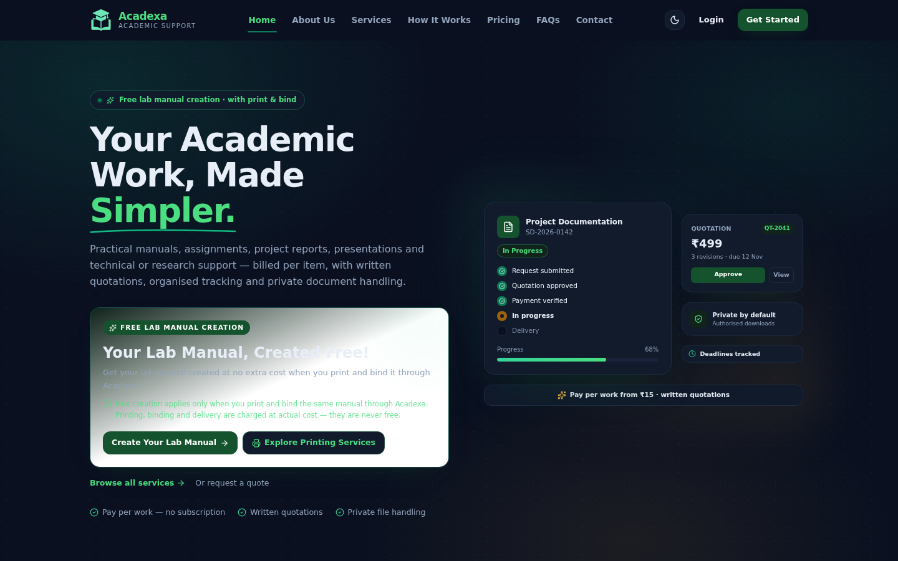
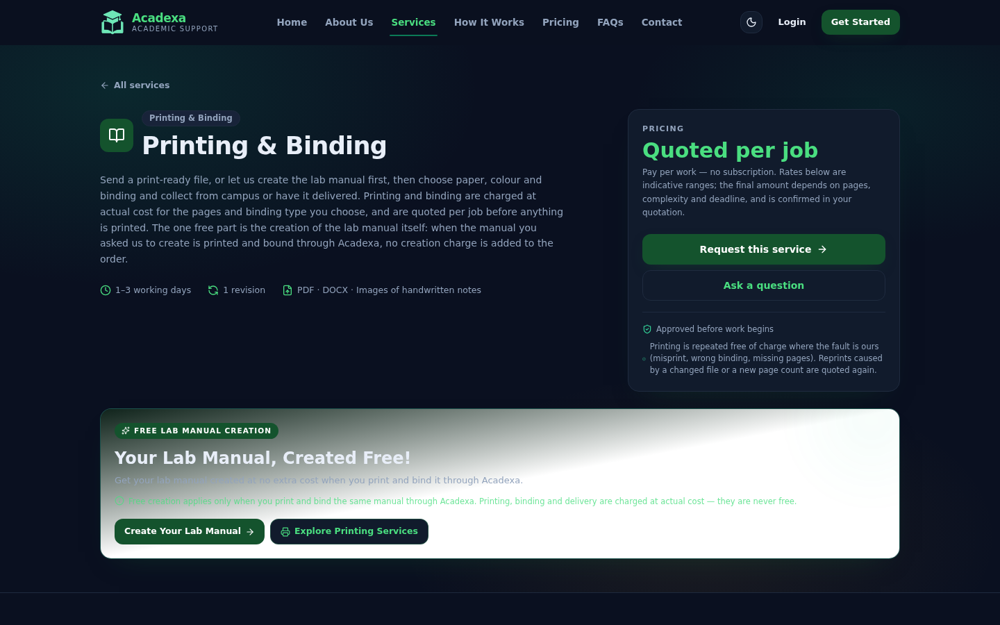
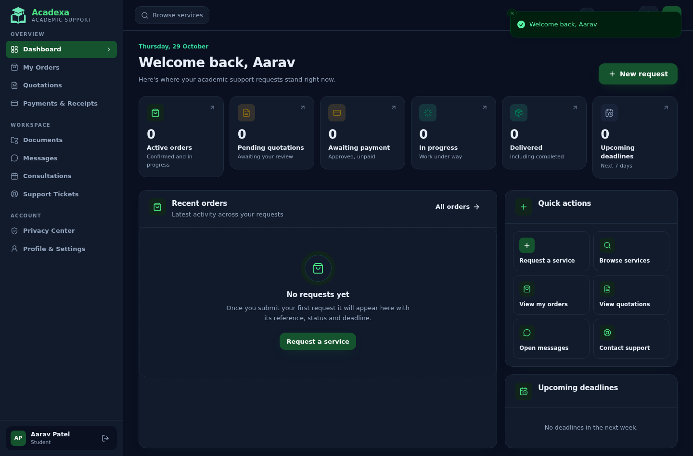
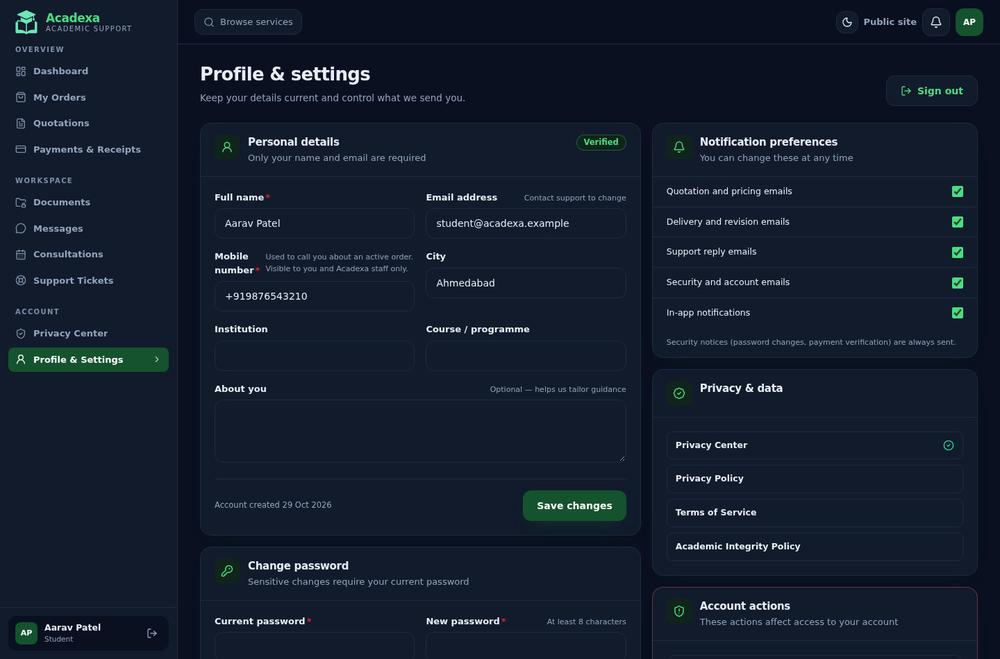

---

## 19. Admin → student detail view

**Students → Detail view** opens `/admin/students/:id`, one screen that answers "where is this student's work?".

| Panel | What it shows / does |
|---|---|
| Identity | Name, email (mailto), mobile number (click-to-call), city, institution, joined date, account and verification badges, and Activate / Suspend |
| Counts | Active work · Completed · Cancelled or rejected · Stored files — computed from real records, never seeded numbers |
| Work & status | Every request with its reference, service, deadline, agreed amount and payment status. A status dropdown offers only the **legal next transitions** for that order, and Update applies it: the student is notified, the change is audited, and treating it like the order page means the same rules apply |
| Uploaded documents | Every live file across all of the student's orders: filename, size, type, kind (student upload / revision upload / deliverable), the order it belongs to, the **storage provider holding it**, and upload date |
| Per-file actions | Download (authorised stream) and **Delete** |

### Deleting a file from here really deletes the document

The Delete button opens a confirmation that names the provider and states that the student will no longer be able to
download the file. Confirming calls `DELETE /api/files/:id`, which:

1. destroys the object in **Cloudinary** (`uploader.destroy`, private asset, with the recorded resource type) — or
   unlinks it from local disk when Cloudinary is not configured;
2. marks the `FileRecord` `isDeleted` with `purgedAt`, `purgedBy` and `purgeReason: 'manual_delete'`, so the order
   history still shows that a file existed and who removed it;
3. writes an audit entry (`file.deleted`) and refreshes the view.

Because the record is kept rather than dropped, the student's file count drops immediately while the trail stays
intact. Owners can still download their own files; nobody else can.

**Verified live:** downloaded and deleted a real uploaded PDF as an admin — the file disappeared from
`.data/uploads`, the student's overview stopped listing it, the summary count dropped to 0, and a student session
could no longer reach it. Covered by a test asserting the stored object is gone from disk after an admin delete.

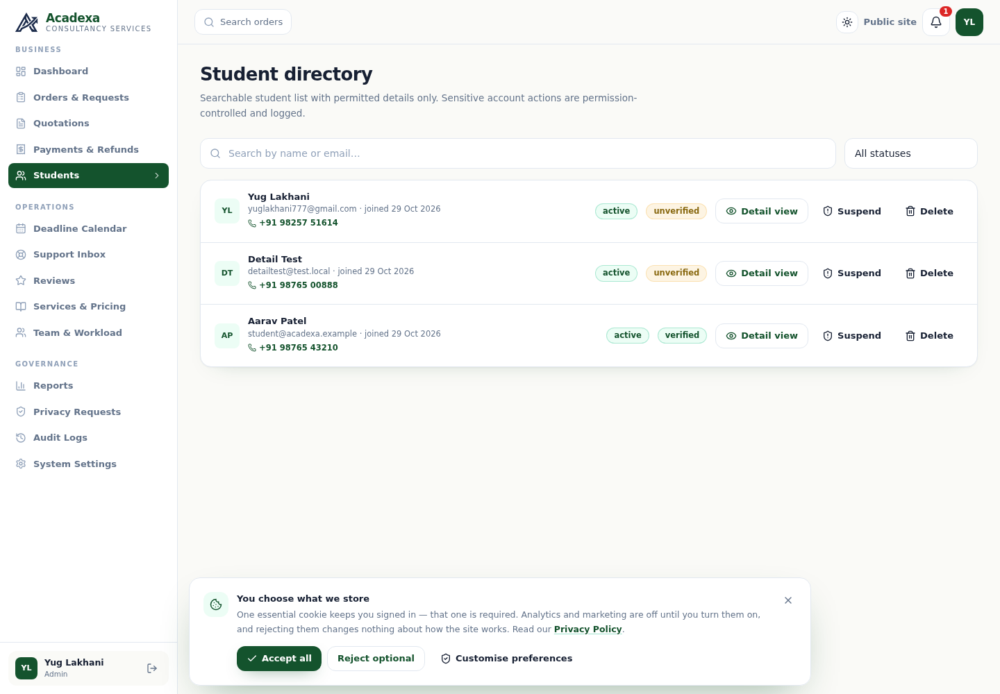
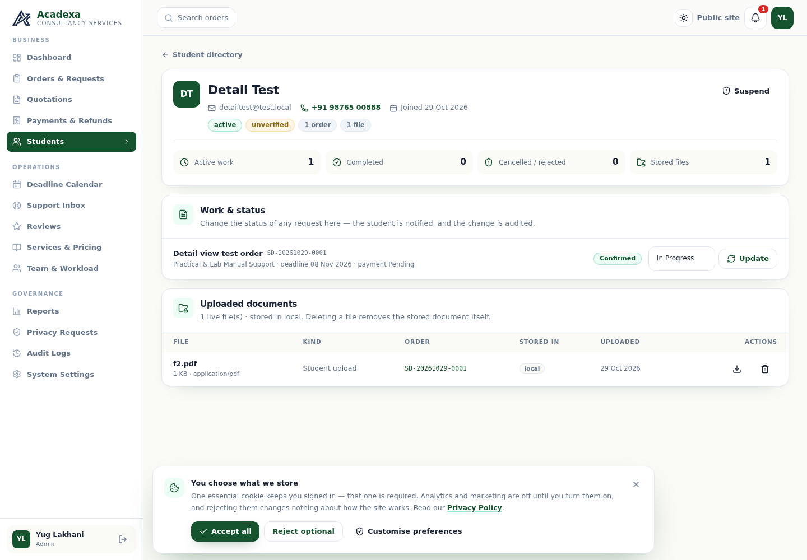
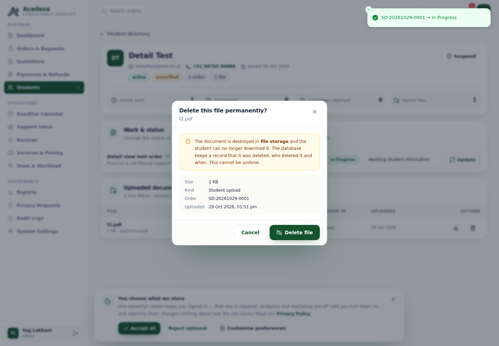

---

## 20. Branding

| Item | Value |
|---|---|
| Name | **Acadexa** |
| Descriptor | **Consultancy Services** (matches the supplied lockup; the navbar wordmark reads "Acadexa / Consultancy Services") |
| Logo — light mode | `client/src/assets/acadexa-logo.png` — navy monogram on a transparent background |
| Logo — dark mode | `client/src/assets/acadexa-logo-dark.png` — light silver monogram, same artwork |
| Source artwork | Supplied lockups kept in `client/public/acadexa-lockup.png` (used for social preview) |
| Icons | `favicon.ico` / `favicon.png` / `apple-touch-icon.png` regenerated from the monogram |

The two logo files are extracted from the supplied artwork as **transparent PNGs containing only the monogram** —
the baked-in wordmark was cropped away so the live text can carry the name and stay selectable, localisable and
theme-aware. `LogoMark` picks the file by theme, and the intro splash does the same via CSS, so both surfaces stay
in step. Replacing either PNG requires no code change.


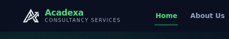

---

**Renaming the app** — the display name currently comes from two places: hardcoded strings in the client,
and `SystemSettings.business.name` in MongoDB (editable at **Admin → Settings**). Updating the admin setting
changes the name in the footer, policies and receipts immediately with no redeploy.

**Deliberately still on the old domain** — `acadexa.example` is a placeholder used in seed accounts, the
canonical URL, `robots.txt` and `sitemap.xml`. Replace it with the real domain before launch. The seeded
demo accounts (`*.example`) are test data, not real mailboxes.

---

## 21. Contact, consultancy and bulk printing

The free lab manual offer only makes sense next to the two paid services it is talked about with, so every
placement of the offer now carries a **contact & bulk printing** block — a real phone number, a real WhatsApp
link, and an explicit statement of what is free and what is not.

### What the block says

| Card | Chip | Copy | Action |
|---|---|---|---|
| **Free Lab Manual Creation** | `Free` | "Get your lab manual created at no extra cost when you print and bind it through Acadexa." + the condition | **See the lab manual service** → `/services/practical-lab-manual-support` |
| **Consultancy Services** | `Charged` | "For any consultancy-related work, contact or WhatsApp +91 98257 51614." + "Scope, fees and timeline are agreed in writing before any work starts." | **Contact for Consultancy** → WhatsApp, message pre-filled |
| **Bulk Printing & Doorstep Delivery** | `Charged` | "Ordering multiple printed documents? Acadexa can arrange delivery to your location." + "For bulk orders, delivery details and pricing, message us at +91 98257 51614." | **Enquire About Bulk Printing** → WhatsApp, message pre-filled |

The header states the split in one sentence — *manual **creation** is free when you print and bind through Acadexa;
printing, binding, delivery and consultancy are charged at actual cost and are quoted to you before you pay* — and
the footer adds both channels as buttons (`WhatsApp +91 98257 51614`, `Call now`) plus the reminder that orders,
quotations and payments stay on the platform.

### Number handling

`client/src/lib/contact.js` is the single source: display form `+91 98257 51614`, dial target `tel:+919825751614`,
and `wa.me/919825751614` deep links with a pre-filled first message per intent (consultancy, bulk printing,
lab manual, general). WhatsApp is opened with `target="_blank" rel="noopener noreferrer"`; the number itself is a
`tel:` link in the header pill, the footer buttons, the site footer and the Contact page, so it dials from a
keypad and messages from WhatsApp. The same number is now the seeded `SystemSettings.business.phone/whatsapp`
(and its schema default), so a reseed cannot reintroduce the old placeholder — asserted in the API tests.

### Where it appears

| Page | Placement |
|---|---|
| Homepage | Full-width block directly beneath the hero, i.e. immediately under the hero offer card |
| Pricing | Directly beneath the offer card, above the billing models |
| Services listing | Beneath the offer card, above the filter bar |
| Lab manual service page | Beneath the offer card, inside the service header section |
| Printing & binding service page | Same |
| Contact page | Above the enquiry form, so bulk and consultancy intents route to WhatsApp first |

### Design

One component (`components/marketing/ContactPrintingInfo.jsx`) with a header, three cards that collapse to one
column on mobile, and a footer strip. Every paid card is chipped **Charged** and the free card is chipped **Free**,
so the distinction survives skimming. It uses the semantic theme tokens, so light and dark mode both work without
a second design, and it is a `Reveal` so it fades in with the rest of the page. The WhatsApp glyph is a small
inline SVG (`components/ui/WhatsAppIcon.jsx`) because Lucide has no brand marks; the links' text always names the
channel, and the glyph is `aria-hidden`.

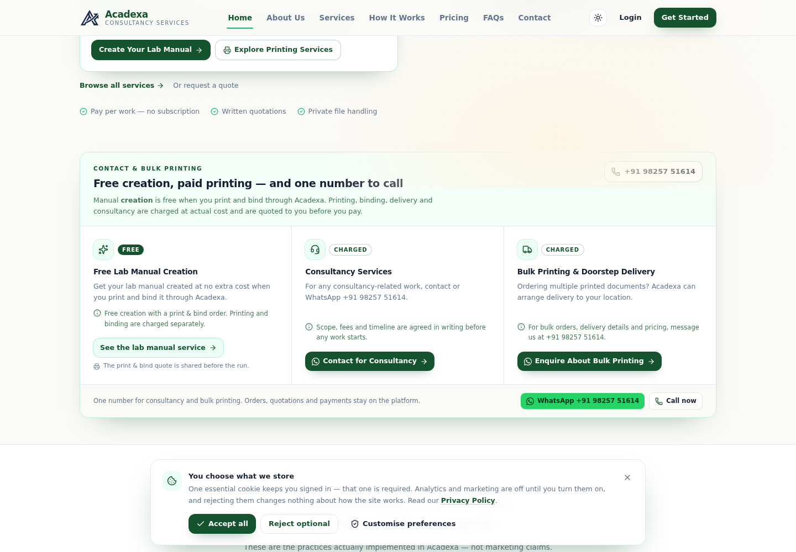
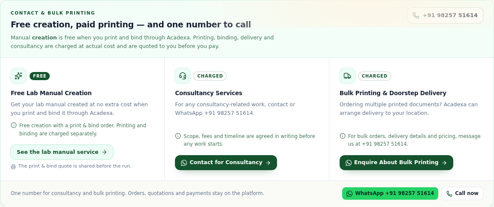
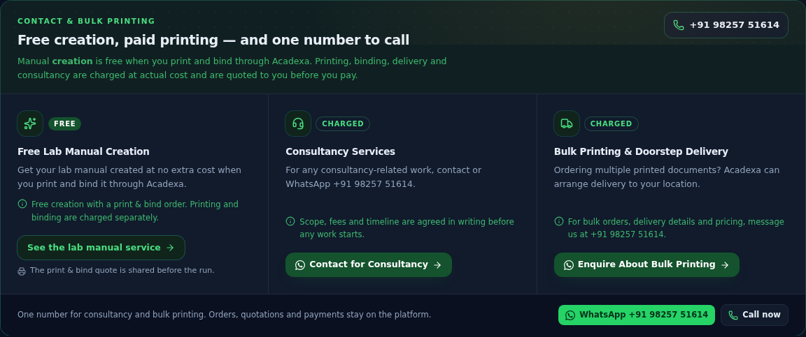
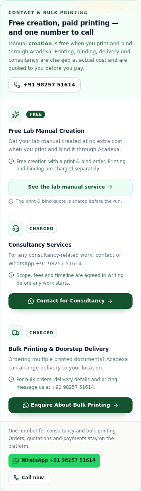
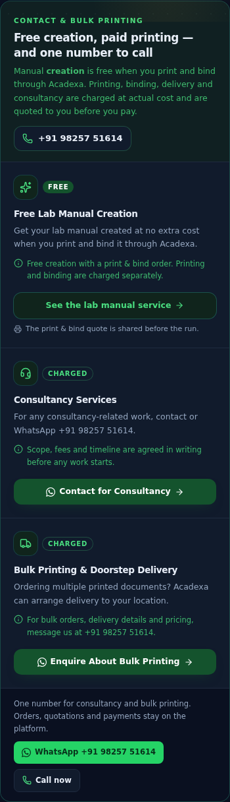
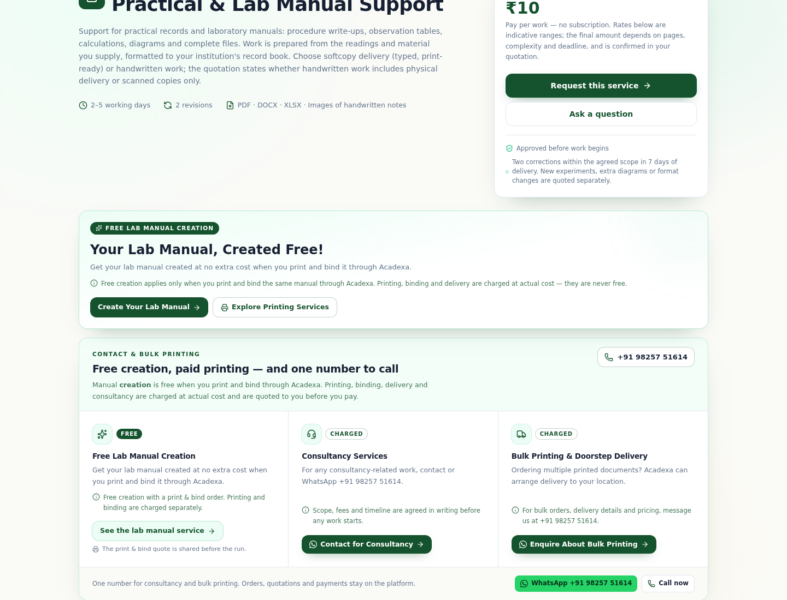
